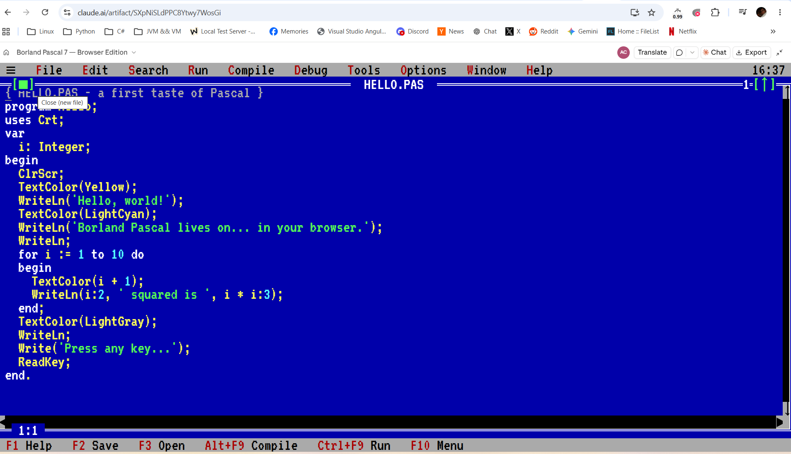

# Borland Pascal 7 — Browser Edition

A browser-based recreation of Borland Pascal 7, delivered as a single self-contained HTML file. This project reproduces the classic DOS-era Pascal IDE experience in the browser, including the editor, compiler, and runtime environment.



## Overview

This repository contains an HTML application that emulates the Borland Pascal 7 workflow:

- Source editor with line numbers and syntax highlighting
- Pascal compiler and interpreter implemented in JavaScript
- Runtime host for console-style programs
- Classic menu bar, status bar, and editor layout
- No external build step required

The app is designed to be easy to run locally and is intended as a nostalgic, educational, and functional browser port of the original Pascal environment.

## Repository contents

- `Borland Pascal 7 — Browser Edition.html` — the full application, including CSS, JavaScript, and Pascal runtime logic

## How to run

### Option 1: Open directly in a browser

Open the HTML file in any modern browser:

- `Borland Pascal 7 — Browser Edition.html`

### Option 2: Run a local web server

From the repository root:

```bash
python -m http.server 8000
```

Then open:

```text
http://localhost:8000/
```

## Features

- Borland-style IDE window layout
- Pascal syntax highlighting
- Program compilation and execution within the browser
- Text-based user screen and keyboard input support
- Dialogs, menus, and mouse/keyboard interactions inspired by classic Turbo Pascal tooling

## Project notes

This project is best viewed as a browser-hosted demo or emulator rather than a full modern Pascal toolchain. It preserves the feel of classic Borland development while running entirely in client-side JavaScript.

## License

This project does not appear to include an explicit license file. If you plan to redistribute or adapt this code, confirm the repository owner’s licensing intent before publishing or using it beyond personal experimentation.

## Suggested next steps

- Add a README screenshot or demo GIF
- Include sample `.PAS` programs
- Add a proper project structure and optional packaging for easier hosting
- Document supported Pascal language features and limitations
